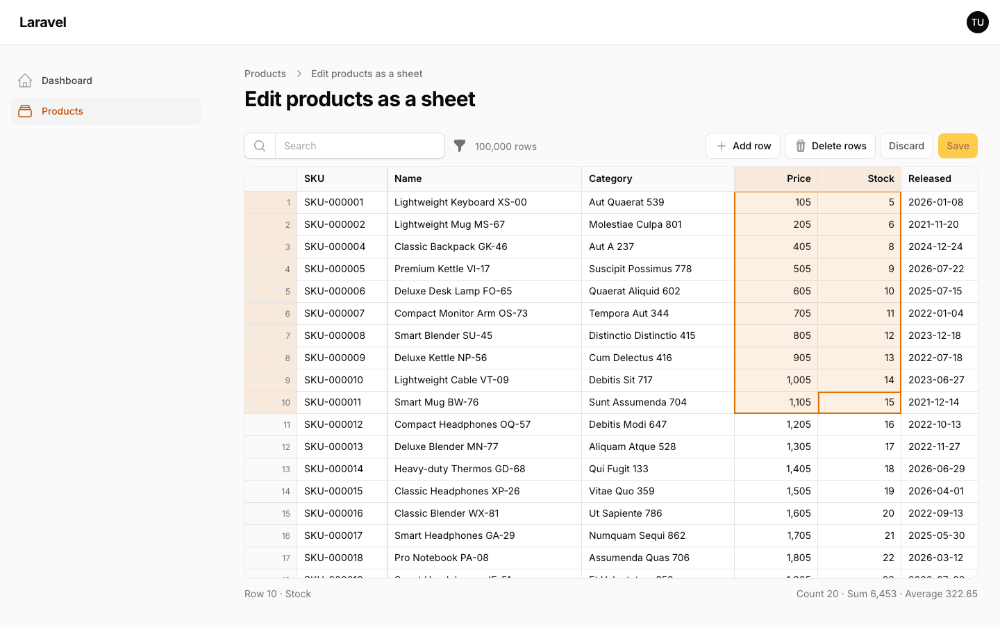
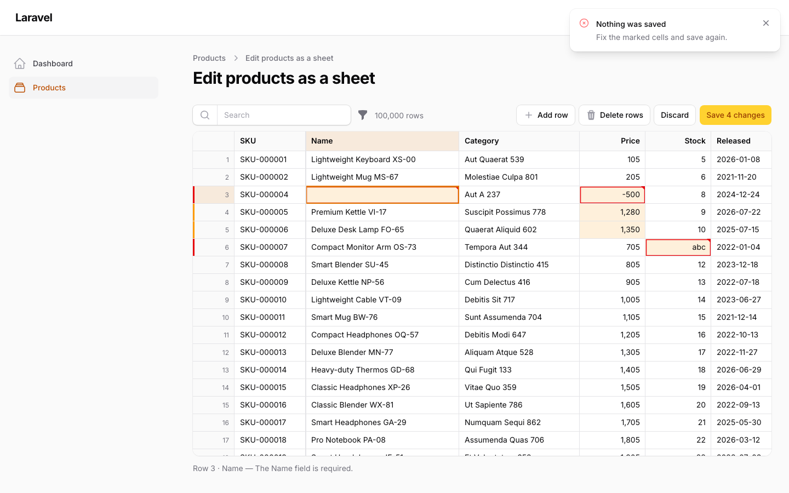
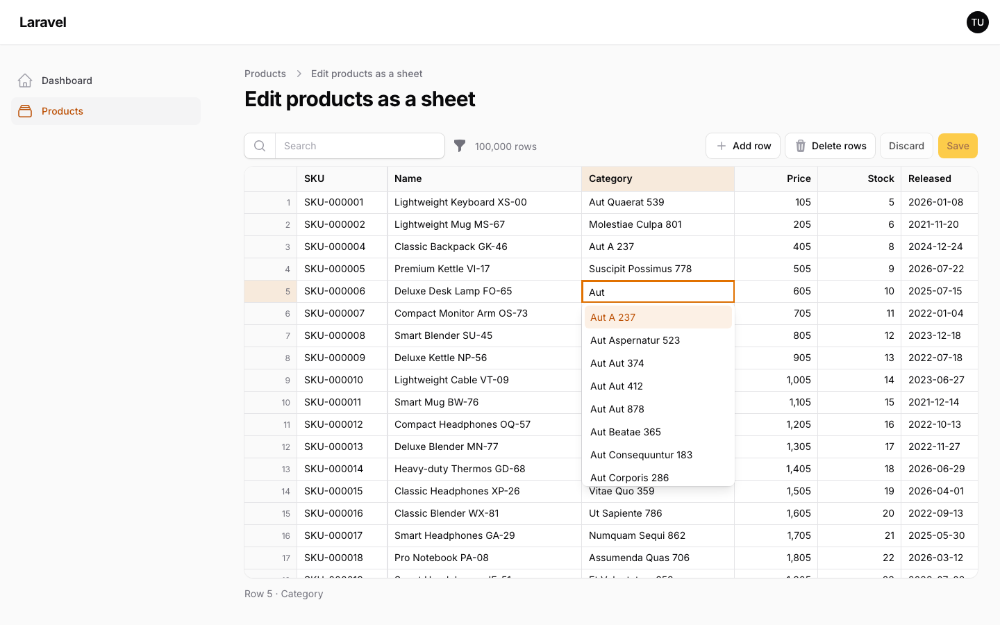
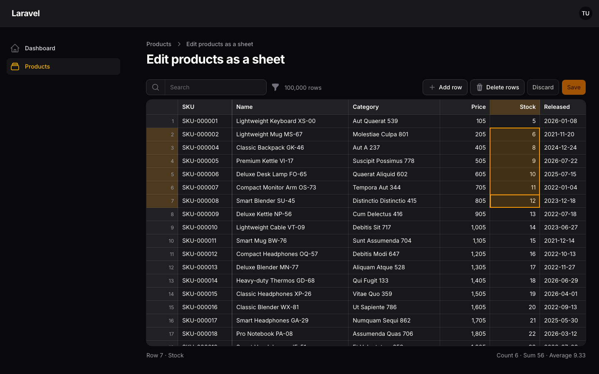

# Warp Sheet



**Turn a Filament resource into a spreadsheet: scroll through every record without pagination, edit and paste like Excel, and save all changes in one go — with your policies, validation and conflict checks.**

<a href="https://demo.warpui.com/sheet"></a>

Scroll through 100,000 products, paste from Excel, group by category and save every change at once at **[demo.warpui.com/sheet](https://demo.warpui.com/sheet)**. No sign-up needed; the data is reset every hour.

Price updates, stock counts and cleaning up a customer list usually mean exporting to Excel, fixing the file and importing it again. Warp Sheet lets your users do that work inside Filament. They see the whole query result as one sheet, move around with the keyboard, paste a block of cells from Excel or Google Sheets, and press Save. The server checks every changed record against its policy and your rules, writes everything in one transaction or nothing at all, and marks the cells that need attention.

```php
use Qalainau\FilamentWarpSheet\Columns;
use Qalainau\FilamentWarpSheet\Pages\SheetPage;
use Qalainau\FilamentWarpSheet\Sheet;

class EditProductsSheet extends SheetPage
{
    protected static string $resource = ProductResource::class;

    public function sheet(Sheet $sheet): Sheet
    {
        return $sheet
            ->columns([
                Columns\Text::make('sku')->readOnly()->frozen(),
                Columns\Text::make('name')->rules(['required', 'max:255']),
                Columns\Number::make('price')->decimals(0)->rules(['required', 'integer', 'min:0']),
                Columns\Select::make('category_id')->relationship('category', 'name'),
                Columns\Date::make('released_on'),
                Columns\Boolean::make('is_active'),
            ])
            ->creatable()
            ->deletable();
    }
}
```

## Why

Measured with 100,000 products and 1,000 categories, on the server only:

| | SQLite | MySQL 8.4 | PostgreSQL 18 |
| --- | --- | --- | --- |
| List all 100,000 records (sorted by a column) | 18 ms | 29 ms | 66 ms |
| Load a chunk of 200 rows while scrolling | 5 ms | 6 ms | 7 ms |
| Save 1,000 changed rows | 0.05 s | 0.06 s | 0.07 s |
| Save 20,000 changed rows | 0.6 s | 0.8 s | 1.0 s |
| Save 100,000 changed rows | 3.0 s | 3.8 s | 4.6 s |

The sheet is drawn on a `<canvas>`, so 100,000 rows cost no more DOM than 100. Only the rows on screen are loaded. Saves are processed 500 rows at a time, so memory stays flat however many rows change.

## Features



- **The whole result, no pages**: scroll or jump to row 100,000 at once. Sort by clicking a header (select columns sort by their labels), search, and filter with Filament's own table filters.
- **Spreadsheet editing**: a cell cursor, typing replaces the cell (Japanese and other input methods included), F2 edits it, Shift extends the selection, a fill handle that continues series, fill down and right, undo and redo, and frozen columns. The status bar shows the count, sum and average of the selection.
- **Paste from Excel**: tab-separated cells from Excel, Numbers or Google Sheets. `1,234` (or `1.234,5` in a decimal-comma language) is read as a number, `2026/10/14` as a date, and labels of a select column as its values. Paste or fill down far past the loaded rows; the sheet tracks every change by primary key.
- **One save, all or nothing**: changes stay in the browser until the user saves. Each record is checked against your resource's `canEdit`, `canCreate` and `canDelete` and against the column rules, inside one transaction. Errors are marked on the cells and nothing is written until everything passes.
- **Conflicts**: when someone else changed a record after it was loaded, the save stops and shows their values — unless they changed other columns, in which case the changes are merged.
- **Review before saving**: a panel lists every unsaved change with its old and new value, to jump to it or revert it.
- **Import, export and bulk edit**: export the filtered records to Excel or CSV, edit them anywhere, and import the file back as changes to review; or change one column of thousands of records at once on the server.
- **Columns and views**: resize, hide and reorder columns, and save the arrangement with the sort, search and filters as private or shared views.
- **Grouping**: group the rows by a column, with counts and subtotals per group, and collapse groups.
- **Large saves**: tens of thousands of changes are sent in parts and written in batches, with progress in the toolbar.
- **Select columns with many options**: a searchable dropdown; relationships with more than 1,000 options are searched on the server as you type.
- **Column types**: text, multi-line text, numbers with currencies, selects (including enums and searched relationships), multi-selects for `belongsToMany`, dates, date-times, times and booleans, with per-record read-only cells and colors.
- **Pages, widgets and relation managers**: a sheet can be a resource page, a dashboard widget, or a relation manager on a record's page, with as many on one page as you like.
- **Multi-tenancy**: on a panel with Filament's tenancy, each team sees, edits and saves views of its own records only. See [Multi-tenancy](#multi-tenancy).
- **Browser tests**: a small JavaScript API to find where a cell is on the canvas, read what it holds, and wait until loading and saving are done. See [Browser tests (JavaScript)](#browser-tests-javascript).
- **Filament integration**: a resource page, panel colors and fonts, dark mode, notifications, modal actions, save hooks and translations (English, Japanese, German, French, Spanish, Italian, Brazilian Portuguese, Korean and Chinese, simplified and traditional).

| Select editor | Dark mode |
| --- | --- |
|  |  |

## Requirements

- PHP 8.3+
- Laravel 12 or 13
- Filament 5.x (Livewire 4)
- SQLite 3.25+, MySQL 8.0+, MariaDB 10.11+ or PostgreSQL 14+ (grouping uses window functions)

### Tested on

Before each release, the full test suite runs on PHP 8.3, 8.4 and 8.5 × Laravel 12 and 13 × SQLite, MySQL, MariaDB and PostgreSQL, with each database at its newest and its oldest supported version: 42 combinations in all. A version is released only when every combination passes.
[See the results for each release](https://github.com/qalainau-labs/filament-warp-sheet-docs/tree/main/test-runs).

## Installation

> **Warp Sheet is a commercial plugin.** A license is required. After purchase you receive credentials for the private Composer repository.

Add the repository and authenticate:

```bash
composer config repositories.qalainau composer https://qalainau.privato.pub/composer
composer config --auth http-basic.qalainau.privato.pub "your-email" "your-license-key"
```

This writes your license key to `auth.json` in the project. Add `auth.json` to `.gitignore`, and on CI or servers pass the credentials in the `COMPOSER_AUTH` environment variable instead.

Install the package, run the migration and publish Filament's assets:

```bash
composer require qalainau/filament-warp-sheet
php artisan migrate
php artisan filament:assets
```

The migrations create two tables: `warp_sheet_views` for the views users save, and `warp_sheet_changes` for the history of sheets with `auditLog()`. Your tables are not changed. To edit the migration, publish it with `php artisan vendor:publish --tag=filament-warp-sheet-migrations`. Publish it before you run `php artisan migrate` for the first time: Warp Sheet then runs your copy instead of its own. If the tables already exist, change them with a migration of your own instead.

> Run `php artisan filament:assets` again after every update of the package.

### AI coding assistants (Laravel Boost)

Warp Sheet ships instructions for AI coding assistants such as Claude Code, Cursor and Codex. If your app uses
[Laravel Boost](https://laravel.com/docs/boost), the assistant learns how to use Warp Sheet from them: which classes to extend, where each kind of rule belongs, what is easy to get wrong, and how to test a sheet.

- **Guidelines** (`resources/boost/guidelines/core.md`): a short summary that Boost adds to `CLAUDE.md`,
  `AGENTS.md` and the other agent files. It also points the assistant to this README in `vendor/`, so it reads the
  documentation of the version you have installed instead of guessing.
- **Skill** `warp-sheet-development` (`resources/boost/skills/`): the steps for adding a sheet, where each kind of rule belongs (column rules, read-only cells, policies, rules across columns), and writing feature and browser tests. The assistant loads it when it works on a sheet.

Boost does not add guidelines of other vendors' packages on its own. When `php artisan boost:install` asks
"Which third-party AI guidelines/skills would you like to install?", select `qalainau/filament-warp-sheet`. To do
it without the question, add the package to `boost.json` and run the command again:

```json
{
    "packages": ["qalainau/filament-warp-sheet"]
}
```

```bash
php artisan boost:install --guidelines --skills -n
```

After you update Warp Sheet, run `php artisan boost:update` so the assistant gets the instructions of the new
version.

## Usage

### Create a sheet page

Create a page in your resource that extends `SheetPage` and describe the sheet in `sheet()` (see the example at the top). Then register it in the resource's `getPages()`:

```php
public static function getPages(): array
{
    return [
        'index' => ListProducts::route('/'),
        'sheet' => EditProductsSheet::route('/sheet'),
        // ...
    ];
}
```

Link to it from the list page with a header action, for example `Action::make('sheet')->url(ProductResource::getUrl('sheet'))`.

Users who can open the resource can open the sheet. Each changed record is checked with the resource's `canEdit()`, new rows with `canCreate()` and deleted rows with `canDelete()`.

The sheet shows the records of the resource's `getEloquentQuery()`, so its scopes and tenancy apply (see [Multi-tenancy](#multi-tenancy)). Pass another query with `$sheet->query(...)`; every read and write of the sheet stays inside that query.

### Columns

```php
use Qalainau\FilamentWarpSheet\Columns;
```

| Column | Notes |
| --- | --- |
| `Columns\Text` | Searched by the search box unless you call `$sheet->searchable([...])`. |
| `Columns\Textarea` | Several lines. Shown on one line in the cell; the editor grows while editing. Alt+Enter (Option+Enter on a Mac) adds a line break. |
| `Columns\Number` | `->decimals(int)`, `->currency('USD')`, `->prefix('$')` and `->suffix(' kg')` set how it is shown, in the page language. Typed and pasted values may include them and thousands separators (`$1,234`), and are read with the page language's separators: in German `12,50` is 12.5, `1.234,5` is 1234.5 and `1.250` is 1250. The other separator, used once and not followed by exactly three digits, is a decimal point (`12.5` in German, `12,50` in English). Number cells of Excel files keep their value in every language. |
| `Columns\Select` | `->options([...])`, `->enum(Status::class)` (labels from Filament's `HasLabel`) or `->relationship('category', 'name')` (`belongsTo`). Sorted by label. |
| `Columns\MultiSelect` | Several values: `->relationship('tags', 'name')` (`belongsToMany`, saved with `sync()`), or `->options([...])` / `->enum(...)` on an attribute cast to an array. Shown as small labels; typed and pasted as labels separated by commas (`Sale, Eco`), with the list completing the last one. Not sortable. |
| `Columns\Date` | Stored as `Y-m-d`. Accepts pasted `2026/10/14`. |
| `Columns\DateTime` | Shown as `Y-m-d H:i`, or with seconds after `->seconds()`. `->timezone('Asia/Tokyo')` shows and reads it in another timezone than the app's; the column filter's dates are that timezone's days too. Accepts pasted `2026/10/14 9:05`. |
| `Columns\Time` | Shown as `H:i`, or with seconds after `->seconds()`. |
| `Columns\Image` | A thumbnail of the value: a URL, a path on `->disk('public')`, or `->url(fn ($value, $record) => ...)`. `->circular()` for photos of people. Read-only unless you call `->readOnly(false)`. |
| `Columns\Link` | Text shown as a link. Ctrl/Cmd+click (or the right-click menu) opens it in a new tab; a plain click selects the cell as usual. The value is the URL unless you build one with `->url(fn ($value, $record) => ...)`. `javascript:` and `data:` URLs never open. |
| `Columns\Computed` | Read-only number worked out from other columns: `->formula('price * stock')`. See below. |
| `Columns\Boolean` | Space toggles the selected cells. Accepts pasted `true`, `yes`, `1`, `✓` and their opposites. |

Dates, times and numbers typed in full-width characters by a Japanese input method (`１，２００`, `２０２６／１０／１４`) are read as usual.

Columns are named `Columns\Text` and so on so they do not clash with Filament's `TextColumn` imports.

All columns accept `->label()`, `->width()`, `->readOnly()`, `->frozen()` and `->rules()`. Rules that depend on the record (such as `unique` ignoring it) take a closure that receives the record, or `null` for a new row:

```php
Columns\Text::make('sku')->rules(fn (?Model $record): array => [
    'required',
    Rule::unique('products', 'sku')->ignore($record),
]),
```

Rules may name another column of the same record, such as a price that may not be lower than the cost, or an end
that must come after the start:

```php
Columns\Number::make('price')->rules(['required', 'numeric', 'gte:cost']),
Columns\Number::make('cost')->rules(['required', 'numeric', 'min:0']),
```

The rule sees the saved values of the record's other columns together with the changed ones. When only the cost is
changed, the price rule that names `cost` is checked again, and its message is shown on the price cell. This works for
Laravel's string rules (`gte:cost`, `after:starts_on`, `required_if:status,closed`). A rule object that reads other
columns only runs when its own cell is changed; for those, and for checks across several records, use
[`afterSave()`](#hooks) and throw `SaveAborted`.

#### Columns from related records

Show an attribute of a related record by naming the column after the relationship and the attribute, with a dot — as in Filament's tables. A stock count line that belongs to a product can show the product's SKU, name and unit without copying them onto the line:

```php
Columns\Text::make('product.sku')->label('SKU')->frozen(),
Columns\Text::make('product.name')->label('Product'),
Columns\Text::make('product.category.name')->label('Category'),   // relationships of relationships work too
Columns\Number::make('product.cost')->decimals(2),
Columns\Number::make('counted_quantity')->rules(['nullable', 'integer', 'min:0']),
```

- **Read-only, never saved.** A related column is always read-only, also after `readOnly(false)`. Values sent for it are ignored, so a save never writes to the related record. To change the related record, open it in its own resource.
- **No extra queries per row.** The relationships of these columns are eager-loaded with every chunk of rows, so 200 rows cost one query for the rows and one for each relationship.
- **Empty when there is no related record.** A line whose `product_id` is empty shows an empty cell; nothing fails.
- **Sorting, search and filters** work in the database: sorting reads the related value with a subquery, so rows without a related record sort like empty cells; the search box and Ctrl/Cmd+F look into related text columns (they are searched by default like any text column); and the column filter keeps the rows whose related record matches (a row without a related record is not kept, also with "empty cells" ticked).
- **Totals, export and import:** `summarize()` works on related columns, the export writes them like any column, and a related column can be the import key, for example `->importable(key: 'product.sku')` to match a file's rows by the product's SKU.
- **Relationships:** use `belongsTo`, `hasOne` and `morphOne` (one related record), nested as deep as you like. A relationship with many records (`hasMany`, `belongsToMany`) shows their values joined with commas; it then sorts by one of them, so prefer a `MultiSelect` for those.
- **Not available:** grouping by a related column, and using it in a computed column's formula (the formula throws when the sheet is built). Copy the value onto the record when you need those.

#### Totals

`summarize()` adds a row of totals at the bottom of the sheet, for every record matching the search and filters — not only the rows on screen:

```php
Columns\Number::make('stock')->summarize('sum'),
Columns\Number::make('price')->summarize(['avg', 'min', 'max']),
Columns\Text::make('sku')->summarize('count'),
```

`sum`, `avg`, `min` and `max` work on number and computed columns, `count` (filled values) on any column. They are worked out in one query on the saved values, and again after each save.

A column you have not resized grows to fit its totals, so a large sum is never cut off. If a user drags it narrower, pointing at the total shows it in full, and double-clicking the header edge fits the column to its values and totals again.

A column without any value yet (no stock counted, or a filter that matches no records) shows `Sum 0` and `Count 0`, as a spreadsheet does, and `—` for the average, the minimum and the maximum: there is nothing to average, and `0` would look like a real value. Group subtotals follow the same rule.

#### Computed columns

```php
Columns\Computed::make('stock_value')->formula('price * stock')->currency('USD')->decimals(0),
Columns\Computed::make('margin')->formula('round((price - cost) / price * 100, 1)')->suffix('%'),
```

Formulas use numbers, the names of the sheet's other columns, `+ - * /`, parentheses, and `round(x, decimals)`, `min(…)`, `max(…)` and `abs(x)`. The browser recalculates them as soon as a column they use changes, before saving. They sort in the database (the formula becomes SQL) and are exported. An empty value or a division by zero makes the result empty, as in SQL. An invalid formula throws when the sheet is built.

#### Checking values as they are typed

Simple rules are also checked in the browser the moment a cell changes — `required`, `numeric`, `integer`, `min`, `max`, `between`, `email`, `url` and the date formats of the date and time columns — so a wrong value is marked before the user saves, with Laravel's message for the rule. The server still checks every rule on save, including the ones the browser cannot (`unique`, `exists`, closures). Rules given as a closure (record-dependent rules) are only checked on the server.

#### Read-only cells and colors

`readOnly()` also takes a closure that receives the record, or `null` for a new row, to lock cells record by record. A column that can only be filled in on a new row:

```php
Columns\Text::make('sku')->readOnly(fn (?Product $record): bool => $record !== null),
```

`color()` colors a cell with one of the panel's colors (`danger`, `warning`, `success`, `info`, `primary`, `gray` or your own). Pass a closure to decide by value. It receives the cell's value (for a computed column, the computed result) and the record:

```php
Columns\Number::make('stock')->color(fn (?int $value): ?string => match (true) {
    $value === 0 => 'danger',
    $value < 20 => 'warning',
    default => null,
}),

Columns\Computed::make('difference')
    ->formula('counted_quantity - expected_quantity')
    ->color(fn (?int $value): ?string => match (true) {
        $value > 0 => 'success',
        $value < 0 => 'danger',
        default => null,
    }),
```

Colors follow the user's edits before they save. When a row is changed (or added), the sheet sends its unsaved values to the server, which puts them on a copy of the record — nothing is saved — and runs your closure again. The answer comes back a moment later, so a count typed into `counted_quantity` colors `difference` straight away. Only the rows on screen are asked for, a few hundred at a time, and an answer for values that changed again in the meantime is dropped.

- Until the first answer for a row arrives, its changed cells and computed cells have no color; after that, the previous colors stay until the next answer.
- A value that does not fit its column (letters in a number column, an impossible date) gives the row no colors until it is fixed. Rules that query the database (`unique`, `exists`) are not checked for this; they are checked on save.
- The closure runs on a record with the unsaved values filled in but not saved, so do not save anything in it. A `MultiSelect` of a `belongsToMany` relationship keeps its saved values there.
- A fixed color (`->color('info')`) needs no request and stays on changed cells.

`readOnly()` closures are still decided on the server from the saved values.

#### Select columns with many options

A relationship with more than 1,000 options is not embedded in the page; the editor searches it on the server as you type, with prefix matches first. Change the threshold with `->preloadLimit(int)` (`0` always searches on the server, `null` always embeds). Pasted labels are matched to values on the server, case-insensitively.

### Column widths, order and visibility

Users can drag the edge of a header to resize a column (double-click it to fit the contents), and use "Columns" in the toolbar to hide columns and move them left or right. Frozen columns stay first. The arrangement is remembered in the browser for each sheet page.

### Saved views

"Views" in the toolbar saves the current arrangement — column widths, order and visibility, sort, search and filters — under a name. Signed-in users see their own views and the ones shared with everyone, can make one their default (the sheet opens with it), and delete their own. "Default view" goes back to the sheet as defined.

```php
$sheet
    ->shareableViews(false)   // views stay private
    ->savedViews(false)       // or turn saving off
    ->viewKey('products');    // share views between pages that show the same sheet (defaults to the page class)
```

Views are stored per tenant when the panel has tenancy (see [Multi-tenancy](#multi-tenancy)).

### Grouping rows

Open the menu of a column header (the funnel) and choose "Group by this column". The rows are ordered by that column — select columns by their labels — and every group gets a heading row with its value, its number of rows and the column summaries (`summarize()`) of its records, worked out in the database. Click a heading's arrow, press Space on it, or use the right-click menu to collapse and expand groups; the toolbar has "Collapse all", "Expand all" and a button to stop grouping. Sorting sorts within each group, and saved views remember the grouping.

Text, select, boolean, date and number columns can be grouped by. Turn it off for a column with `->groupable(false)`. A column with more than 5,000 different values in the result is not grouped. Rows added while grouped are listed in a "New rows" group at the end; after a save the groups are worked out again.

Values that the database treats as equal share a group: with a case-insensitive collation (MySQL's default), "Apple" and "apple" are one group, named after its first row. A date column groups by day even when the database column also stores times, and its subtotals cover the whole day. Grouping by another column opens every group again.

### Find and replace

Ctrl/Cmd+F opens a find bar over the sheet; Enter and Shift+Enter go to the next and previous matching cell, and matching cells are highlighted. It searches every record matching the search and filters, not only the rows loaded: the server finds the rows whose text columns or select labels contain the text, and the browser then checks the cells as they are shown, unsaved changes included (also with "Match case"). Number and date cells match in rows already found.

Ctrl+H, or the arrow in the find bar, shows replace. "Replace" changes the current cell and "Replace all" every text cell that matches, in up to 10,000 rows; both are unsaved changes to review and save, and Replace all is one undo step. For more rows, use the bulk edit's find and replace.

### Column filters

Every column header has a filter button, as in Excel: text columns filter by what they contain, numbers and computed columns by a range, dates and times by a period, and selects, multi-selects and booleans by a list of values (including empty cells). The panel also sorts the column. Column filters run in the database, so they cover every record, and they apply to the totals, the export, bulk edit and saved views. "Clear column filters" in the toolbar removes them all. Nothing needs to be configured.

### Filters

Pass Filament table filters to the sheet. They appear in the toolbar and narrow the records the sheet lists:

```php
use Filament\Tables\Filters\Filter;
use Filament\Tables\Filters\SelectFilter;
use Filament\Tables\Filters\TernaryFilter;

$sheet->filters([
    SelectFilter::make('category_id')->relationship('category', 'name')->searchable()->multiple(),
    TernaryFilter::make('is_active'),
    Filter::make('out_of_stock')->query(fn (Builder $query): Builder => $query->where('stock', 0)),
]);
```

### Opening a record

Double-click a row number, or right-click a row and choose "Open record" (Shift+F10 or the menu key from the keyboard), to open the record in the resource's form in a modal — for the fields the sheet does not show, such as long descriptions or relationships. Records the user may not edit open read-only. After a save the sheet reloads its rows; unsaved changes stay. The right-click menu also adds and deletes rows.

It needs a form on the resource. Turn it off with `$sheet->recordModal(false)`.

### Adding and deleting rows

`->creatable()` adds an "Add row" button and `->deletable()` a "Delete rows" button. New rows are validated against every column's rules, so `required` works; columns the user left empty get the database default. Deleted rows are struck through until the save.

### Saving

"Review" in the toolbar lists the unsaved changes record by record — new rows, deleted rows and each changed cell with its old and new value. Click one to go to it, or revert a cell or a whole record (Ctrl/Cmd+Z brings it back).

The save is all or nothing. Deletes are processed first, then updates, then new rows, so a new row may reuse a unique value of a deleted one.

A record changed by someone else after it was loaded is a conflict only when the same column changed; changes to other columns are merged. Rows written without being loaded (for example by pasting far below the visible rows) are a conflict when they changed after the sheet listed the records. Conflicts use `updated_at`, so the model needs timestamps for them. Most databases keep `updated_at` in whole seconds, so a record changed in the same second as the listing also counts as a conflict. Rows with unsaved changes keep the version they were edited on when the sheet reloads its rows (after a bulk edit or the record form), so someone else's change in between is still a conflict. A changed record that someone else deleted is taken out of the sheet with its changes, and the sheet says so.

After a save the sheet shows the saved rows as the database has them, so columns written by an observer, a trigger or a generated column appear straight away. The totals are worked out again, also for columns that are hidden. If a model event (`saving`, `updating`, `creating`, `deleting`) returns `false`, nothing is saved and the record is marked with an error.

By default a save may touch up to 100,000 records:

```php
$sheet->maxChangesPerSave(20_000); // or null for no limit
```

Rows are written with prepared `UPDATE` statements rather than `Model::save()`, which is several times faster. On MySQL, MariaDB and PostgreSQL, rows that change the same columns are written 100 at a time in one statement. If the model has event listeners (observers, `saving`/`updated` hooks and so on), the sheet saves through Eloquent so they still run. Force either way with `$sheet->modelEvents(true)` or `$sheet->modelEvents(false)`.

### Bulk edit

`bulkEditable()` adds "Bulk edit" to the toolbar. It changes one column of the selected rows, or of every record matching the search and filters — including the rows not loaded yet — on the server:

| Change | Columns |
| --- | --- |
| Set to a value, clear | All |
| Add values, remove values | MultiSelect |
| Find and replace (optionally matching case) | Text, Textarea |
| Add an amount, change by a percentage (rounded to the column's decimals) | Number |

The new values go through the same path as a save: the resource's `canEdit()`, the column rules, `beforeSave()`/`afterSave()`, and one transaction, so if any record fails, nothing is changed. Records whose cell is read-only for them are skipped. The sheet then reloads the rows; unsaved changes stay. Date times and times are set as typed, in the column's timezone, whatever the panel's Filament timezone.

```php
$sheet->bulkEditable();
```

### Export

`exportable()` adds "Export" to the toolbar, with Excel (.xlsx) and CSV. It writes the saved records with the sheet's current search, filters and sort, one column per sheet column: select columns as labels, booleans as `TRUE`/`FALSE` and dates as `Y-m-d`, so the file can be imported again. Values a spreadsheet would read as formulas are written as text. Unsaved changes are not in the file.

```php
$sheet
    ->exportable()                 // or ->exportable(['csv'])
    ->exportFileName('products');  // defaults to the table name
```

The Excel export needs PHP's `zip` extension. 100,000 rows take a few seconds and about 50 MB of memory.

### Import

`importable()` adds "Import" to the toolbar. The user picks a CSV, TSV or Excel (.xlsx) file; it is read in the browser, not uploaded. The header row is matched to the columns by name or label, and each row is matched to a record by the key column — the primary key by default, or any column you name:

```php
$sheet->importable(key: 'sku');
```

Only the cells whose values differ become changes, so the user can review them ("Review") and save as usual, with the same policies, validation and conflict checks. Rows whose key is not found become new rows if the sheet is `creatable()`. The whole import is one undo step. Columns that are not in the sheet, and read-only columns, are ignored. CSV files may be UTF-8 or Shift_JIS (Japanese Excel's default), and dates in Excel files are read as dates.

An exported file can be imported again unchanged, so "export, edit in Excel, import" is a round trip. 100,000 rows take a few seconds.

### Widgets and relation managers

A sheet can also be a dashboard widget or a relation manager. The `sheet()` method is the same; each sheet on a page has its own search, filters, views and unsaved changes. When one sheet saves (also through bulk edit or the record form), the other sheets on the page that show the same model reload their rows; their unsaved changes stay.

A widget extends `SheetWidget`. It checks `canView()` and, for edits, the model's policy (`update`, `create`, `delete`) if it has one. It is 28rem tall unless you set `height()`, and has no resource form, so pass one to open rows:

```php
use Filament\Forms\Components\TextInput;
use Qalainau\FilamentWarpSheet\Widgets\SheetWidget;

class OutOfStock extends SheetWidget
{
    protected static ?string $heading = 'Out of stock';

    public function sheet(Sheet $sheet): Sheet
    {
        return $sheet
            ->query(Product::query()->where('stock', 0))
            ->columns([
                Columns\Text::make('name')->readOnly(),
                Columns\Number::make('stock')->rules(['required', 'integer', 'min:0']),
            ])
            ->recordForm([
                TextInput::make('name')->required(),
            ])
            ->recordTitleAttribute('name');
    }
}
```

A widget on a dashboard with filters can use Filament's `InteractsWithPageFilters` and read `$this->pageFilters` in `sheet()`. When the dashboard filters change, the sheet lists its records again:

```php
use Filament\Widgets\Concerns\InteractsWithPageFilters;

class OutOfStock extends SheetWidget
{
    use InteractsWithPageFilters;

    public function sheet(Sheet $sheet): Sheet
    {
        return $sheet
            ->query(Product::query()->where('stock', 0)->when(
                $this->pageFilters['category'] ?? null,
                fn ($query, $category) => $query->where('category_id', $category),
            ))
            ->columns([/* … */]);
    }
}
```

A relation manager extends `SheetRelationManager` and edits a `hasMany` or `morphMany` relationship. Its query is the relationship's, and rows added in the sheet belong to the owner record. It checks the relation manager's `canEdit()`, `canCreate()` and `canDelete()` (read-only on view pages when the panel says so) and opens rows with its `form()`:

```php
use Qalainau\FilamentWarpSheet\RelationManagers\SheetRelationManager;

class ProductsRelationManager extends SheetRelationManager
{
    protected static string $relationship = 'products';

    public function sheet(Sheet $sheet): Sheet
    {
        return $sheet
            ->columns([
                Columns\Text::make('name')->rules(['required']),
                Columns\Number::make('stock')->rules(['required', 'integer', 'min:0']),
            ])
            ->creatable()
            ->deletable();
    }
}
```

### History

`auditLog()` records every save from the sheet — including bulk edits and imports — in the `warp_sheet_changes` table, inside the save's transaction: one row per record and save, with the operation, the old and new value of each changed column, the user and the time. Right-click a row and choose "History" to see it, newest first, with column and option labels.

```php
$sheet->auditLog();
```

Changes made outside the sheet (the record's own form, other code) are not recorded. The table can grow large; prune it as you would any log, for example with `SheetChange::where('created_at', '<', now()->subYear())->delete()` in a scheduled command.

### Hooks

`beforeSave()` runs at the start of the save's transaction and `afterSave()` after every record is written, in the same transaction. Use them for an audit log or to update related data. The callbacks are called through Laravel's container, so they receive services, and `afterSave()` receives the primary keys of the saved records by name:

```php
use Qalainau\FilamentWarpSheet\Exceptions\SaveAborted;

$sheet
    ->beforeSave(function (): void {
        if (Inventory::isLocked()) {
            throw new SaveAborted('Stock is locked while the warehouse is counting.');
        }
    })
    ->afterSave(function (array $created, array $updated, array $deleted): void {
        AuditLog::record('products', $created, $updated, $deleted);
    });
```

If a hook throws, nothing is saved. A `SaveAborted` exception shows its message to the user; any other exception shows the generic "Saving failed" message.

### Other options

| Method | Default |
| --- | --- |
| `$sheet->chunkSize(int)` | 200 rows loaded per request while scrolling |
| `$sheet->height(string)` | The rest of the window, so the page does not scroll. Adjusted when the window is resized. On a page with a long description above it, the sheet stays at least 28rem tall (about 11 rows), or 60% of a short window, and the page scrolls instead. Pass a CSS height to fix it |
| `$sheet->searchable(array)` | all text columns |

### Security

- **What users can see is the sheet's query.** Every read and write — rows, saves, deletes, history, import, export, bulk edit — stays inside `query()` (the resource's `getEloquentQuery()` on a page, the relationship on a relation manager). Hiding a column or filtering rows only changes the view: every column of the sheet is sent to the browser for the rows on screen. Leave out of the query the records users must not see, and out of the columns the attributes they must not read.
- **Writes are checked record by record** with the policies (`canEdit()`, `canCreate()`, `canDelete()`) and the column rules. A widget uses the model's policy; without a policy it allows every change, so add one or make the columns `readOnly()`.
- **Keys:** do not make a key column writable (the primary key or a foreign key) unless users may move records with it. A relation manager always makes its parent key read-only, and a panel with tenancy always makes the tenant key read-only (see [Multi-tenancy](#multi-tenancy)).
- **Select columns** check new values against the relationship's query — its own constraints, global scopes and tenancy — and `relationship('category', 'name', fn (Builder $query) => ...)` narrows it further. On a panel with tenancy, see [which options are scoped](#multi-tenancy).
- **Links and images** open only `http`, `https`, `mailto` and `tel` URLs. Image columns load their URLs in every viewer's browser; when users can type them, prefer `disk()` or `url()`.
- **Messages:** `SaveAborted` and validation messages are escaped before they are shown in Filament notifications.
- **Limits:** a user can export 10 times a minute and save 100 views per sheet; staged parts of large saves are limited in size and number.

### Translations

The sheet ships with English, Japanese, German, French, Spanish, Italian, Brazilian Portuguese, Korean and Chinese (simplified and traditional); it follows the app's locale. To change the wording or add a language, publish the translations:

```bash
php artisan vendor:publish --tag=filament-warp-sheet-translations
```

## Multi-tenancy

Filament panels can serve many teams (or companies, or shops) from one app with [multi-tenancy](https://filamentphp.com/docs/users/tenancy): `$panel->tenant(Team::class)`. Warp Sheet supports it, so a SaaS can give every team a sheet of its own records. There is nothing to switch on. On a panel without tenancy, the sheet works exactly as before.

### Setting up the panel

This is Filament's own setup; the sheet needs nothing more. A full example with a `Team` model, users who belong to several teams, and products that belong to one team:

```php
// app/Providers/Filament/AppPanelProvider.php
use App\Models\Team;

public function panel(Panel $panel): Panel
{
    return $panel
        ->id('app')
        ->path('app')
        ->login()
        ->tenant(Team::class, slugAttribute: 'slug')   // URLs like /app/acme/products
        ->discoverResources(in: app_path('Filament/Resources'), for: 'App\Filament\Resources');
}
```

```php
// app/Models/User.php
use Filament\Models\Contracts\HasTenants;
use Filament\Panel;

class User extends Authenticatable implements HasTenants
{
    public function teams(): BelongsToMany
    {
        return $this->belongsToMany(Team::class);
    }

    public function getTenants(Panel $panel): Collection
    {
        return $this->teams;
    }

    public function canAccessTenant(Model $tenant): bool
    {
        return $this->teams()->whereKey($tenant)->exists();
    }
}
```

```php
// app/Models/Team.php
class Team extends Model
{
    public function products(): HasMany
    {
        return $this->hasMany(Product::class);
    }
}

// app/Models/Product.php
class Product extends Model
{
    public function team(): BelongsTo   // the "ownership relationship"
    {
        return $this->belongsTo(Team::class);
    }
}
```

The sheet page is the same as on any panel:

```php
class EditProductsSheet extends SheetPage
{
    protected static string $resource = ProductResource::class;

    public function sheet(Sheet $sheet): Sheet
    {
        return $sheet
            ->columns([
                Columns\Text::make('sku')->rules(fn (?Model $record): array => [
                    'required',
                    // unique inside the team (see "Things to watch" below)
                    Rule::unique('products', 'sku')->where('team_id', Filament::getTenant()?->getKey())->ignore($record),
                ]),
                Columns\Text::make('name')->rules(['required']),
                Columns\Select::make('category_id')->relationship('category', 'name'),
                Columns\Number::make('stock'),
            ])
            ->creatable()
            ->deletable();
    }
}
```

### What is kept per team

- **Rows.** Filament scopes the models of the panel's resources to the current team. The sheet reads through that scope, so every read and write — rows, totals, groups, find, saves, deletes, bulk edit, import, export, history and opening a record — only reaches the current team's records. A key of another team's record sent from the browser is treated like a record that does not exist: a change to it is reported as a conflict, a delete does nothing, and loading it returns nothing. Opening another team's URL is refused by Filament.
- **New rows.** Filament puts the current team on a record when it is created, so rows added in the sheet (also in widgets, relation managers and imports) belong to the team that added them.
- **The tenant key is read-only.** The column of the ownership relationship — `team_id`, the type and id of a `morphTo`, or a `MultiSelect` of a `belongsToMany` ownership — is read-only in the sheet, so users can neither move a record to another team nor create one there. You can still show the column. Values sent for it are ignored.
- **Select options.** A select column's options, the labels of pasted values and the check of saved values use the relationship's query with its global scopes. When the related model has a resource in the panel (say `CategoryResource`), only the current team's options are offered and accepted. Otherwise narrow the options yourself (see below).
- **Saved views.** Views are stored with the team. A team sees only its own views, and a shared view is shared with the other members of the team.
- **The column arrangement** that the browser remembers for each sheet page is not stored per team. It holds no data, only widths, order and visibility.

### Columns and migrations

- **Your table** needs the column of the ownership relationship, for example `$table->foreignId('team_id')->constrained()`, as for any Filament resource with tenancy. Warp Sheet adds no columns to your tables.
- **Warp Sheet's tables:** `warp_sheet_views` stores the team in `tenant_type` and `tenant_id`, and the user in `owner_type` and `owner_id`; the history table (`warp_sheet_changes`) stores the user in `user_type` and `user_id`. These key columns are text, so teams and users with UUID or ULID keys work. The history table has no team column; it is only read through a record of the sheet, which is already scoped.
- **Upgrading from 1.0.x:** run `php artisan migrate`. The migration `update_warp_sheet_keys_to_strings` turns `owner_id`, `tenant_id` and `user_id` from integer into text columns and keeps the saved views and the history. (Before, a team or a user with a UUID or ULID key could not save views or history on MySQL, MariaDB and PostgreSQL.) If you published Warp Sheet's migrations, publish them again with `php artisan vendor:publish --tag=filament-warp-sheet-migrations` and migrate.

### Not scoping, and other relationship names

The sheet follows the settings of Filament's tenancy:

```php
// Every team's records on one resource (an admin overview, shared data):
class ProductResource extends Resource
{
    protected static bool $isScopedToTenant = false;
}
```

The sheet of such a resource shows every team's records and does not lock the tenant key.

```php
// Another name for the ownership relationship, for the whole panel...
$panel->tenant(Team::class, ownershipRelationship: 'owner');

// ...or for one resource:
class NoteResource extends Resource
{
    protected static ?string $tenantOwnershipRelationshipName = 'owner';
}
```

The sheet locks the column of the relationship with that name. The ownership relationship may also be `belongsToMany` through a pivot table (`teams()`); the rows are then scoped through the pivot table, and new rows are attached to the current team.

A sheet with its own `$sheet->query(Product::query()...)` is scoped the same way, as long as the model has a resource in the panel. Do not call `withoutGlobalScopes()` on it.

### Things to watch

- **Models without a resource in the panel** are not scoped by Filament. This matters for a widget or a relation manager on such a model, and for a select column whose related model has no resource. Scope them yourself:

  ```php
  use Filament\Facades\Filament;

  $sheet
      ->query(Note::query()->whereBelongsTo(Filament::getTenant()))
      ->newRecordUsing(fn (): Note => new Note(['team_id' => Filament::getTenant()->getKey()]))
      ->columns([
          Columns\Select::make('category_id')->relationship(
              'category',
              'name',
              fn (Builder $query) => $query->whereBelongsTo(Filament::getTenant()),
          ),
          // ...
      ]);
  ```

- **Unique rules:** Laravel's `Rule::unique()` does not know about teams. Add the team to the rule, as in the example above, and to the unique index of the table (`$table->unique(['team_id', 'sku'])`).
- **Your own code** in `beforeSave()`, `afterSave()`, policies and column rules runs inside the panel's request, so `Filament::getTenant()` returns the current team there.
- **No routes or jobs:** the sheet has no routes, queued jobs or notifications outside the panel. Exports are streamed in the same request, so they are scoped too.

### Adding tenancy to an app that already has saved views

Views saved before the panel had tenancy have no team, so once you add `->tenant(...)` to the panel, no team sees them. They are not deleted, only hidden. Give them to one team with an Artisan command:

```bash
# See what would change: the tables and how many rows have no tenant. Nothing is changed.
php artisan warp:assign-tenant "App\Models\Team" 1 --dry-run

# Give those rows to the team with the key 1
php artisan warp:assign-tenant "App\Models\Team" 1
```

- The first argument is the tenant model's class or its morph alias, the second its key. The command stops if there is no such record.
- Only rows without a tenant are changed. Rows that already belong to a team are left as they are.
- It covers every installed Warp plugin at once: Warp Sheet's `warp_sheet_views`, and the tables of Warp Pivot, Warp Floor and the others if they are installed. Every plugin registers the same command, so you run it once. The history (`warp_sheet_changes`) has no team column and needs nothing.
- Everything happens in one database transaction. If one row can't be moved (another plugin's row would clash with a row the tenant already has), nothing is changed and the command says why.
- Your own tables are not touched: fill their `team_id` yourself, as for any Filament resource.
- `custom` in place of the model (`php artisan warp:assign-tenant custom acme`) is for plugins that keep a tenant key without a model (`tenantKeyUsing()` in Warp Floor, for example). Warp Sheet's views belong to the panel's tenant model, so name the model for them.

### Testing with tenancy

A record or saved view of another team is treated as if it did not exist. There is no special "wrong tenant" error and no 403, so in your tests, don't expect an exception; check what the team sees.

| What the test sends with another team's key | What happens (the same as for a missing key) |
| --- | --- |
| Load rows (`warpSheetRows`) | The row is not returned |
| Change a cell (`warpSheetSave` with `updates`) | Not saved: `saved` is `false` and the key is in `conflicts` with `row` = `null` (as for a row someone else deleted) |
| Delete a row (`warpSheetSave` with `deletes`) | Nothing is deleted; `saved` is `true` |
| Open or delete a saved view | `warpSheetApplyView` returns `null`, `warpSheetDeleteView` returns `false` |

Livewire tests don't go through the team's URL, so set the panel and the tenant yourself, and boot the panel with `Filament::bootCurrentPanel()`. A request to the panel boots it in Filament's middleware; a Livewire test does not, and until the panel is booted Filament has not added the tenant scope to the resource's model or put the current team on new records. Without it, the sheet in your test lists every team's rows and `Product::create()` fails on the empty `team_id`. The rows the team sees come from `warpSheetKeys()` (the keys in the sheet's order, with the totals in `summaries`) and `warpSheetRows($keys)` (the values of each row in `values`), the same calls the browser makes:

```php
use Filament\Facades\Filament;
use Livewire\Livewire;

beforeEach(function () {
    $this->acme = Team::create(['name' => 'Acme', 'slug' => 'acme']);
    $this->globex = Team::create(['name' => 'Globex', 'slug' => 'globex']);

    $user = User::factory()->create();
    $user->teams()->attach([$this->acme->id, $this->globex->id]);
    $this->actingAs($user);

    Filament::setCurrentPanel('app');
    Filament::bootCurrentPanel(); // adds the tenant scopes, as a request to the panel does

    // Filament puts the current team on new records, so create each team's records as that team
    Filament::setTenant($this->globex);
    $this->globexKettle = Product::create(['sku' => 'G-1', 'name' => 'Globex kettle', 'stock' => 7]);

    Filament::setTenant($this->acme);
    $this->acmeKettle = Product::create(['sku' => 'A-1', 'name' => 'Acme kettle', 'stock' => 3]);
});

it('shows only the products of the current team', function () {
    $sheet = Livewire::test(EditProductsSheet::class)->instance();
    $keys = $sheet->warpSheetKeys()['keys'];

    expect($keys)->toBe([$this->acmeKettle->id])
        ->and(array_column(array_column($sheet->warpSheetRows($keys), 'values'), 'name'))->toBe(['Acme kettle']);
});

it('does not change a product of another team', function () {
    Livewire::test(EditProductsSheet::class)
        ->call('warpSheetSave', ['updates' => [['key' => $this->globexKettle->id, 'values' => ['stock' => 99]]]])
        ->assertReturned(fn (array $result) => $result['saved'] === false);

    expect($this->globexKettle->fresh()->stock)->toBe(7);
});
```

To test the page as a whole, request its URL with the team in it: `$this->get(ProductResource::getUrl('sheet', tenant: $this->acme))->assertOk()`. A team the user doesn't belong to gets a 404 from Filament.

## Feature tests (PHP)

Feature tests call the same Livewire methods the browser calls, on the page (or widget, or relation manager) instance. They check the policies, the query and the rules exactly as a user's request does.

| Method | Returns |
| --- | --- |
| `warpSheetKeys()` | `keys`: the primary keys in the sheet's order (with the sort, search and filters you pass), and `summaries`: the totals per column (`['stock' => ['sum' => 12]]`) |
| `warpSheetRows($keys)` | One entry per key the sheet can show: `key`, `version` and `values` by column name (select columns hold the value, not the label) |
| `warpSheetOptions($column, $search = '')` | The options of a select or multi-select column that match the text, as `[[value, label], …]`: labels that start with the text first, then labels that contain it, at most 50. The same query the editor uses, so a test can check that only the current team's categories are offered. An empty text returns the first 50 |
| `warpSheetSave($changes)` | `saved`, `errors` (`[['key' => …, 'messages' => ['column' => 'message']]]`), `conflicts` and `message` (the `SaveAborted` message). A refused save returns `saved => false`; it does not throw |

```php
use Livewire\Livewire;

it('offers only the categories of the products sheet', function () {
    $kitchen = Category::create(['name' => 'Kitchen']);

    Livewire::test(EditProductsSheet::class)
        ->call('warpSheetOptions', 'category_id', 'kit')
        ->assertReturned([[$kitchen->id, 'Kitchen']]);
});

it('refuses negative stock and saves nothing', function () {
    $kettle = Product::create(['sku' => 'K-1', 'name' => 'Kettle', 'stock' => 3]);

    $result = Livewire::test(EditProductsSheet::class)->instance()
        ->warpSheetSave(['updates' => [['key' => $kettle->id, 'values' => ['stock' => -1]]]]);

    expect($result['saved'])->toBeFalse()
        ->and($result['errors'][0]['messages'])->toHaveKey('stock')
        ->and($kettle->refresh()->stock)->toBe(3);
});
```

- `warpSheetSave()` takes `updates` (`key`, and the `values` of the changed columns only, as the browser sends them), `creates` (`id` any string, `values`) and `deletes` (`key`). `creates` only work with `->creatable()` and `deletes` with `->deletable()`; otherwise they are ignored.
- On a panel with tenancy, see [Testing with tenancy](#testing-with-tenancy) first: the panel has to be booted in the test.

## Browser tests (JavaScript)

The sheet is drawn on a canvas, so there are no cell elements in the page to click or read. For Playwright (or any browser test), the sheet has three methods on its Alpine data. Use them instead of the sheet's internal objects (`grid`, `model`), which change between releases.

```js
import { test, expect } from '@playwright/test'

test('the stock of a product can be changed in the sheet', async ({ page }) => {
    const sheet = (method, argument) =>
        page.evaluate(([method, argument]) => Alpine.$data(document.querySelector('.fi-warp-sheet'))[method](argument), [method, argument])

    await page.goto('/admin/products/sheet')
    await page.waitForFunction(() => window.Alpine && Alpine.$data(document.querySelector('.fi-warp-sheet'))?.whenIdle)
    await sheet('whenIdle') // the rows on screen are loaded

    // find the cell (the sheet scrolls it into view), click it and type
    const cell = await sheet('cellPoint', { record: '42', column: 'stock' })
    // { record: '42', column: 'stock', row: 41, x: 912, y: 455, left: 852, top: 439, width: 120, height: 32, visible: true }
    await page.mouse.click(cell.x, cell.y)
    await page.keyboard.type('15')
    await page.keyboard.press('Enter')
    await sheet('whenIdle')

    // the edit is in the sheet but not saved yet
    expect(await sheet('cellValue', { record: '42', column: 'stock' })).toMatchObject({ value: 15, changed: true, error: null })

    await page.getByRole('button', { name: /Save 1 change/ }).click()
    await sheet('whenIdle') // the save has finished

    expect(await sheet('cellValue', { record: '42', column: 'stock' })).toMatchObject({ value: 15, changed: false })
    // check the database here as well
})
```

- **`cellPoint({ record, column })`** or **`cellPoint({ row, column })`** — returns a promise with the position of the cell on the screen. `record` is the record key (a string or a number), `row` the position of the row in the sheet as it is shown now (0 is the first row; with grouping, the group header rows count too), and `column` the column name. If the cell is out of view, the sheet scrolls to it first (and the page too, if the sheet itself is off screen), so a click at `x`, `y` lands on it. `x` and `y` are the center and `left`, `top`, `width`, `height` the box, in the same viewport pixels as `getBoundingClientRect()`. `record` and `row` in the result tell you which record you got. Pass `scroll: false` to measure without scrolling; `visible` then tells you whether the center can be clicked. It returns `null` for a record that is not in the sheet (filtered out, or in a collapsed group), a group header row, and a column that is hidden or does not exist.
- **`cellValue({ record, column })`** or **`cellValue({ row, column })`** — returns a promise with what the cell holds now, including unsaved edits: `{ record, column, value, text, changed, error, deleted }`. `value` is the value as it will be saved (a number for number columns, the option value for selects, an array for multi-selects, `true`/`false` for booleans), `text` the text the cell shows (with the currency and separators; booleans as `TRUE`/`FALSE`), `changed` whether the cell has an unsaved edit, `error` the message of the cell's red mark (a rule checked while typing, or a validation error after a refused save) or `null`, and `deleted` whether the row is marked for deletion. The row does not have to be on screen: if it is not loaded yet, the sheet loads it first, without scrolling. Hidden columns can be read too. It returns `null` for a record that is not in the sheet or is in a collapsed group, a group header row and a column that does not exist.
- **`whenIdle()`** — returns a promise that resolves when the sheet is not listing records (after a sort, search, filter or grouping), not loading rows, not saving or importing, not waiting for cell colors, and has drawn the latest state. It rejects after 10 seconds (`whenIdle({ timeout: 30000 })` to wait longer, for example for a large save).

Things to know:

- Until it is saved, a row you add has the key `new:1`, `new:2` and so on (in the order the rows were added), so `cellPoint({ record: 'new:1', column: 'name' })` finds the first one. After the save it has its real key.
- Call `whenIdle()` after pressing Enter or Tab and before `cellValue()`. In a select column that searches on the server, Enter waits for the search to answer before it picks the option, and `whenIdle()` waits for that too.
- Rules the browser checks (`required`, `numeric`, `integer`, `min`, `max`, `between`, `email`, `url` and date formats, see [Columns](#columns)) mark the cell as soon as it changes. The others (`unique`, `exists`, closures) are checked when saving, so their `error` appears after a refused save.
- With several sheets on one page, pick one with `document.querySelectorAll('.fi-warp-sheet')[n]`.

## Keyboard

| Key | Action |
| --- | --- |
| Arrow keys, Tab, Enter | Move the cursor |
| Ctrl/Cmd + arrow keys | Jump to the first or last row or column |
| Shift + movement | Extend the selection |
| Typing | Replace the cell |
| F2 / double-click | Edit the cell |
| Escape | Cancel editing |
| Delete / Backspace | Clear the selected cells |
| Space | Toggle the selected Boolean cells |
| Ctrl/Cmd + A | Select all |
| Ctrl/Cmd + C, V | Copy and paste (tab-separated) |
| Ctrl/Cmd + D, R | Fill down, fill right |
| Ctrl/Cmd + F, Ctrl + H | Find in the sheet, find and replace |
| Ctrl + ; / Ctrl + Shift + ; | Today's date / the current time (into the selected cells, or at the caret while editing) |
| Ctrl/Cmd + Z, Shift+Z / Y | Undo and redo |

Drag the small square at the bottom-right corner of the selection (the fill handle) to extend it in any direction, as in Excel: two or more numbers, dates or texts ending in a number (`Item 1`, `SKU-009`) with an even step continue as a series, a single date or numbered text counts up by one, and anything else is repeated.

## Limitations

- Warp Sheet is a page for whole resources. For rows inside a form, use a repeater.
- Columns are the types above, on the model's own attributes, `belongsTo` relationships (`Select`) and `belongsToMany` relationships (`MultiSelect`). Attributes of related records can be shown read-only (`product.sku`, see [Columns from related records](#columns-from-related-records)).
- No formulas, multiple sheets or Excel formatting — paste values from Excel, not workbooks.
- New rows are saved one by one through Eloquent, to get their primary keys.

## Troubleshooting

**Nothing is drawn.** Run `php artisan filament:assets` after installing or updating, and check that the page shows no JavaScript errors.

**Conflicts on every save.** The sheet compares `updated_at`. Make sure the model uses timestamps and nothing else touches the records between loading and saving.

## Changelog

See [CHANGELOG.md](CHANGELOG.md).

## Support

Ask a question or report a bug at https://warpui.com/support?plugin=sheet. Do not post your license key in your question.

## License

Warp Sheet is commercial software. See [LICENSE.md](LICENSE.md) for the license terms.
